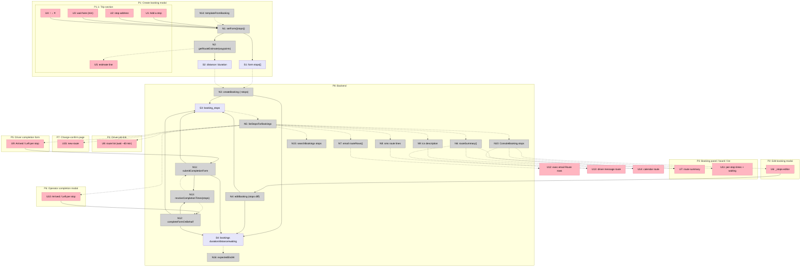

# Multi-stop / wait-and-continue trips — Shaping

## Source

> Multi-stop / wait-and-continue trips: driver waits at a location then continues, or stops somewhere mid-trip — bookings must model this. (change list, 2026-10-18)

> next we need to work on the multi stop system lets start by shaping consider things like how it would look on the create booking and the e2e flow (2026-10-20)

> so im thinking just of rip we do a recording per stop. I believe its transfer only, there are cases where for example they say take me to point a and wait 40 mins and then take me to point b and then back to original dest stuff like that. I think we can just put the first pickup and last destination. I believe its charged through the existing wait charge. So a sceanrio i was given was the one i just gave it could be just small pitstops between two detinations or it could be like a client has a meeting wait at the meeting spot then take them somewhere else afterwards (2026-10-20)

Note: `DESIGN.md` §2 lists "no multi-leg trips" as out of scope. This is an explicit scope change requested by the user.

---

## Problem

A booking today is **pickup → one drop-off** (transfer, with a Directions-estimated drive time) or **hourly as-directed** (no destination, booked hours). Real jobs often are neither:

- "take me to point A, wait 40 minutes, then take me to point B, then back to where we started";
- small pit-stops between two destinations;
- a meeting: wait at the meeting spot, then take the client somewhere else afterwards.

Operators work around it by booking the job as hourly (the destinations vanish from the driver link, exec emails, calendar and the sheet) or by creating two or three bookings (duplicate dispatch, duplicate driver-details emails, price split across tickets, several completion forms). Either way the driver is briefed by phone and the record is wrong.

## Outcome

One booking carries the whole journey — the ordered stops and any planned waits — and every surface that describes the trip (create/edit form, driver link and message, exec emails, calendar, board, sheet, completion) reflects it. Dispatch, the clock and completion stay single: one driver, one lifecycle, one form.

---

## Requirements (R)

| ID | Requirement | Status |
|----|-------------|--------|
| R0 | 🟡 A **transfer** booking can describe an ordered journey: pickup, zero or more intermediate stops, and a final destination, where any intermediate stop may carry a planned wait (for scheduling). Hourly as-directed bookings do not carry stops | Core goal |
| R1 | Stops are entered on the create and edit forms in the Trip section, with the same address autocomplete and postcode rule as pickup/destination; stops can be reordered and removed | Must-have |
| R2 | The driver sees every stop, in order, with planned waits, on the job link page and in the dispatch/job message | Must-have |
| R3 | 🟡 Every surface that describes the trip shows the route: exec emails (confirmation, driver details, update), calendar entries, and a compact summary on board tiles, list rows and search | Must-have |
| R4 | The expected trip end (which drives the clock's in_progress → awaiting_driver_form transition) accounts for every leg's drive time plus planned waits | Must-have |
| R5 | One dispatch, one driver, one completion form per journey — stops never create extra bookings | Must-have |
| R6 | 🟡 On completion the driver (or the operator on their behalf) records the actual arrival and departure at every stop, as well as the existing pickup arrival / on-board / drop-off times. Waiting = pickup wait + Σ (departure − arrival) per stop, charged through the existing £1/min waiting charge with the operator override unchanged. The contract price stays a single figure | Must-have |
| R7 | 🟡 The backup sheet keeps the JJ layout: Address From = first pickup, Address To = final destination; intermediate stops are not mirrored | Decided |
| R8 | Adding, removing or reordering a stop after dispatch goes through the existing change-confirmation flow (driver told, confirmation recorded, exec update email due) | Must-have |

Resolved questions (2026-10-20): per-stop recording on completion — yes; transfer only — yes; sheet shows first pickup and last destination only; waits are charged through the existing waiting charge; a return to origin is simply the destination equal to the pickup (no special option); the sheet's Mileage (S) is the total miles across all legs; the planned wait is shown to the driver as an estimate ("wait ~40 min").

---

## Shapes

### A: Stops as free text

| Part | Mechanism | Flag |
|------|-----------|:----:|
| A1 | New `route_notes` text on the booking ("via Canary Wharf, wait ~1h"); shown to the driver, in emails and on the sheet as a line of text | |
| A2 | Operator types any waits into the duration manually | |

### B: Ordered stops on the booking

| Part | Mechanism | Flag |
|------|-----------|:----:|
| B1 | `booking_stops` table: `booking_id`, `seq`, `address`, `postcode`, `place_id`, `planned_wait_minutes`, plus `arrived_at` / `departed_at` (null until completion); pickup and destination stay on `bookings` as the endpoints; `ON DELETE CASCADE`; index `(booking_id, seq)` | |
| B2 | Trip section gains "Add a stop" between pickup and destination: an address row with the Places autocomplete + postcode field, a "wait here (min)" input, up/down/remove; the same component is used in the edit modal; Zod schema validates the ordered array (max 8 stops) at the server-action boundary | |
| B3 | 🟡 Route estimate in one DirectionsService call with `waypoints: stops.map(location, stopover: true)`; `duration_minutes` = Σ legs' drive time + Σ planned waits; `distance_meters` = Σ legs; the form shows the roll-up ("4 legs · 38 mi · 2h 10m incl. 40 min waiting"). `expectedEndAt` is unchanged (pickup + duration) | |
| B4 | Driver link page and dispatch/job message render the ordered stop list with planned waits; the driver's .ics / Google Calendar description lists the route | |
| B5 | Exec email templates get a "Route" block (Pickup, Stop 1 (wait 40 min), …, Destination) replacing the single Pickup/Destination rows when stops exist | |
| B6 | Edit-booking diff treats the stop list as one field (`stops`) so `editBooking` marks the change driver- and exec-relevant; the change-confirm link page shows the new route | |
| B7 | Sheet: no change — Address From/To already carry the booking's pickup and destination (R7); Mileage (S) is `distance_meters`, which B3 now sums across legs | |
| B8 | Board/list route summary ("Home → City (wait 40m) → LHR") and the search index include stop addresses | |
| B9 | 🟡 Completion: the driver form (and the operator's "Enter completion details" modal) adds an "Arrived / Left" HH:MM pair per stop between the on-board and drop-off fields; `resolveCompletionTimes` chains them with the existing day-rollover anchor and derives `waitingTimeMinutes` = pickup wait + Σ stop waits (12h cap still applies to the total); stop times are written to `booking_stops` | |

### C: Legs as linked bookings

| Part | Mechanism | Flag |
|------|-----------|:----:|
| C1 | Each leg is its own booking with a shared `journey_id`; the console groups them | |
| C2 | Dispatch assigns the whole journey's legs at once | ⚠️ |
| C3 | One completion form per leg | |

---

## Fit Check

| Req | Requirement | Status | A | B | C |
|-----|-------------|--------|---|---|---|
| R0 | A transfer booking can describe an ordered journey: pickup, zero or more intermediate stops, and a final destination, where any intermediate stop may carry a planned wait. Hourly bookings do not carry stops | Core goal | ❌ | ✅ | ✅ |
| R1 | Stops are entered on the create and edit forms in the Trip section, with the same address autocomplete and postcode rule as pickup/destination; stops can be reordered and removed | Must-have | ❌ | ✅ | ❌ |
| R2 | The driver sees every stop, in order, with planned waits, on the job link page and in the dispatch/job message | Must-have | ✅ | ✅ | ❌ |
| R3 | Every surface that describes the trip shows the route: exec emails, calendar entries, and a compact summary on board, list and search | Must-have | ❌ | ✅ | ❌ |
| R4 | The expected trip end accounts for every leg's drive time plus planned waits | Must-have | ❌ | ✅ | ✅ |
| R5 | One dispatch, one driver, one completion form per journey | Must-have | ✅ | ✅ | ❌ |
| R6 | Per-stop arrival/departure recorded on completion; waiting = pickup wait + Σ stop waits through the existing £1/min charge; single contract price | Must-have | ❌ | ✅ | ❌ |
| R7 | The backup sheet keeps the JJ layout: first pickup and final destination only | Decided | ✅ | ✅ | ❌ |
| R8 | Stop changes after dispatch go through change-confirmation | Must-have | ✅ | ✅ | ❌ |

**Notes:**
- A fails R0/R1/R3/R4/R6: free text is not structured, so it cannot be validated, reordered, timed, summarised or completed per stop.
- B passes every row: B3's flag is resolved (DirectionsService `waypoints` returns one leg per segment in a single call) and B7 needs no work under the decided R7.
- C fails most rows: it is the "multi-leg" design DESIGN.md excluded, and it multiplies dispatch, emails and completion; per-leg completion forms also fail R6's single waiting roll-up.

---

## Status

Shaping started 2026-10-20. Questions resolved the same day; **B selected** (user confirmed the create-form sketch and the end-to-end flow, 2026-10-20). Next: breadboard (Detail B) and slice.

## Sketch: create form and end-to-end flow

**Create booking → Trip section (transfer only).** Pickup time · From · [Stop 1: address + postcode · wait here (min) · ↑ ↓ ✕] · [+ Add a stop] · To · the estimate line reads "3 legs · 38 mi · 2 h 10 m (incl. 40 min waiting)" and Duration fills from it. Switching Service to As-directed hides the stops and clears them.

**Dispatch / accept.** Unchanged; the driver's link and message list the route. Operator-attested assign and the job link show the same.

**Clock.** assigned → in_progress at pickup − 1 h; in_progress → awaiting_driver_form at pickup + duration (duration already includes the planned waits).

**Change mid-flight.** Operator edits the stops (add/remove/reorder) → change-confirm link or phone attestation as today → exec "Booking update" email shows the new route.

**Completion.** The driver's form: Arrived at pickup · Passenger on board · [Stop 1: Arrived · Left] · … · Drop-off · Parking. Waiting = (on-board − max(pickup, arrival)) + Σ (left − arrived). Operator review shows the per-stop times and the derived waiting; the waiting-charge override still applies to the total.

**Sheet.** Address From / To unchanged; Waiting Time (Q) and Waiting (T) carry the summed waiting.

---

## Detail B: Concrete affordances

### Places

| # | Place | Description |
|---|-------|-------------|
| P1 | Create booking modal | Existing `new-booking-modal.tsx` |
| P1.1 | Trip section | Subplace: Service · Pickup time · From · **stops** · To · Duration · estimate line |
| P2 | Edit booking modal | Existing `edit-booking-modal.tsx`; reuses the stops editor |
| P3 | Booking panel | Existing `detail-panel.tsx` (hero + Trip card + Completion card); board tiles / list rows share the route summary |
| P4 | Driver job link (view / accept) | `/j/[token]` dispatch + job stages, `JobCard` |
| P5 | Driver completion form | `/j/[token]` completion stage |
| P6 | Operator completion modal | Existing `complete-form-modal.tsx` ("Enter completion details") |
| P7 | Change-confirm link page | `/j/[token]` change stage |
| P8 | Backend | Server actions, services, domain, Postgres |

### UI Affordances

| # | Place | Component | Affordance | Control | Wires Out | Returns To |
|---|-------|-----------|------------|---------|-----------|------------|
| U1 | P1.1 | stops-editor (new) | "Add a stop" button | click | → N1 | — |
| U2 | P1.1 | stops-editor | stop address (AddressAutocomplete + PostcodeField) | type/select | → N1 | — |
| U3 | P1.1 | stops-editor | "Wait here (min)" number input | type | → N1 | — |
| U4 | P1.1 | stops-editor | ↑ ↓ ✕ per stop | click | → N1 | — |
| U5 | P1.1 | new-booking-modal | estimate line "3 legs · 38 mi · 2 h 10 m (incl. 40 min waiting)" | render | — | — |
| U6 | P2 | edit-booking-modal | _stops-editor (same component, pre-filled) | — | → N4 | — |
| U7 | P3 | route-summary (new, shared by panel hero, board tile, list row) | "Home → City (wait 40m) → LHR" | render | — | — |
| U8 | P4 | JobCard | ordered route list with "wait ~40 min" | render | — | — |
| U9 | P5 | completion form | per stop: "Arrived" + "Left" HH:MM inputs (between On board and Drop-off) | type | → N11 | — |
| U10 | P6 | complete-form-modal | per stop: "Arrived" + "Left" HH:MM inputs | type | → N12 | — |
| U11 | P3 | Completion card | per-stop arrived/left + "Waiting 55 min (pickup 15 + stops 40)" | render | — | — |
| U12 | email | exec emails | "Route" rows: Pickup · Stop 1 (wait 40 min) · … · Destination | render | — | — |
| U13 | message | driver dispatch / job / change SMS text | route lines | render | — | — |
| U14 | calendar | .ics / Google Calendar description | route lines | render | — | — |
| U15 | P7 | change page | new route display | render | — | — |

### Code Affordances

| # | Place | Component | Affordance | Control | Wires Out | Returns To |
|---|-------|-----------|------------|---------|-----------|------------|
| N1 | P1 | new-booking-modal | `setForm({ stops })` (reorder/remove/update) | call | → S1, → N2 | — |
| N2 | P1 | lib/routes | `getRouteEstimate(origin, destination, waypoints)` — one DirectionsService call, Σ legs; `+ Σ plannedWait` | call | → S2 | → U5 |
| N3 | P8 | new/actions + services/bookings | `createBookingAction` serialises `stops` JSON → `createBookingSchema.stops` (array, max 8, each address+postcode rule+wait 0–720) → `createBooking` inserts `booking_stops` in the same tx | call | → S3, → S4 | — |
| N4 | P8 | console-actions + services/edit-booking | `editBookingSchema.stops` → `editBooking` diffs `stops` as one field (ordered compare) → replaces `booking_stops` rows in tx; `DRIVER_FACING_CHANGE_LABELS` + `EXEC_FACING_CHANGE_LABELS` gain `'stops'` | call | → S3, → S4 | — |
| N5 | P8 | services/booking-stops (new) | `listStopsForBookings(db, ids)` → `Map<bookingId, Stop[]>` | call | — | → N6, → N7, → N8, → N9, → U8, → U15, → U9, → U10, → U11 |
| N6 | P8 | lib/route-summary (new, pure) | `routeSummary(booking, stops)` | call | — | → U7, → U13, → U14 |
| N7 | P8 | services/email-templates | `routeRows(booking, stops)` replaces Pickup/Destination rows in `assignedEmail`, `driverDetailsEmail`, `changeExecEmail` when stops exist | call | — | → U12 |
| N8 | P8 | services/sms-templates | `dispatchSms`, `driverJobSms`, `changeSms` take `stops` | call | — | → U13 |
| N9 | P8 | lib/ics + /j/[token]/calendar | description lists the route | call | — | → U14 |
| N10 | P8 | services/console-view | `ConsoleBooking.stops` (from N5) | write | — | → U7, → U11, → U6 |
| N11 | P8 | j/[token]/actions + services/completion | `submitCompletionAction` parses `stop[i].arrivedTime/leftTime` → `submitCompletionForm` → N13 → writes `bookings` times + `booking_stops.arrived_at/departed_at` | call | → N13, → S3, → S4 | — |
| N12 | P8 | console-actions + services/completion | `completeFormOnBehalf` same input shape → N13 | call | → N13, → S3, → S4 | — |
| N13 | P8 | domain/completion-times | `resolveCompletionTimes(pickupAt, input, stops)` chains arrival → on-board → stop1 arrived → stop1 left → … → drop-off with the existing day-rollover anchor; `waitingTimeMinutes` = pickup wait + Σ(left − arrived); 12 h cap on the total; new error `stop_times_out_of_order` | call | — | → N11, → N12 |
| N14 | P1 | lib/booking-template | `templateFromBooking` copies `stops` (Copy booking) | call | — | → N1 |
| N15 | P8 | services/bookings-query | `searchBookings` adds `EXISTS (select 1 from booking_stops where address ilike …)` | call | — | → search results |
| N16 | P8 | domain/durations | `expectedEndAt(pickupAt, durationMinutes)` — unchanged, reads S4 | call | — | → clock tick |

### Data Stores

| # | Place | Store | Description |
|---|-------|-------|-------------|
| S1 | P1 | form `stops[]` | `{ address, postcode, placeId, plannedWaitMinutes }[]` in the modal state (and P2's edit form) |
| S2 | P1 | form `distanceMeters` / `expectedDurationMinutes` | Existing fields, now the roll-up from N2 |
| S3 | P8 | `booking_stops` | `id, booking_id, seq, address, postcode, place_id, planned_wait_minutes, arrived_at, departed_at`; `ON DELETE CASCADE`; unique `(booking_id, seq)` |
| S4 | P8 | `bookings.duration_minutes`, `distance_meters`, `waiting_time_minutes` | Existing columns; duration/distance are the roll-up, waiting is the sum |

### Wiring

### Notes on the existing system

- `createBookingSchema` / `editBookingSchema` are `.strict()`; `stops` is added as an optional array that must be empty when `serviceType === 'hourly'` (R0).
- The postcode rule lives at the server-action boundary (see [[postcode-rule-feature]]); the stops editor reuses `PostcodeField` + `withPostcode` so each stop obeys it.
- `editBooking` records `changedFields`; `'stops'` joins both facing-label lists so an added stop sets `driverNotTold` (change-confirm) and `changeExecRelevant` (update email due) exactly like a changed destination.
- The sheet needs no change: Address From/To, Mileage (Σ legs via S4) and the Waiting columns (summed via S4) already read `bookings`.
